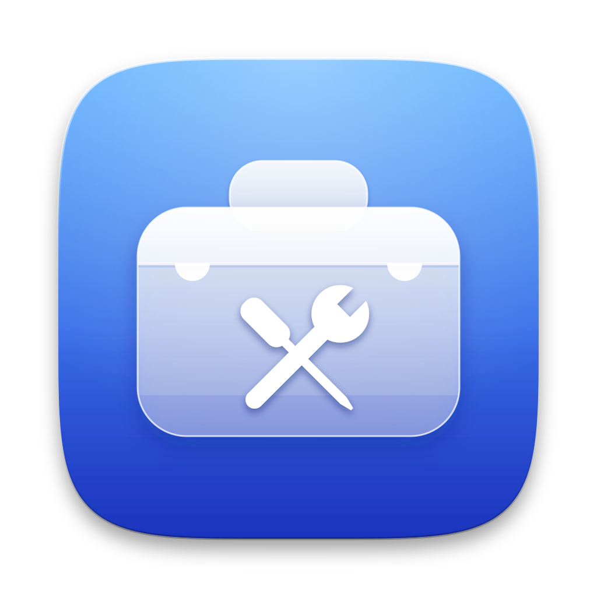

# Kitbag

**The everyday toolkit that lives in your Mac's menu bar.**

One fast, native app instead of a dozen single-purpose utilities. 
Move files, keep a clipboard history, read two-factor codes, dictate text and monitor your Mac, all from one popup.

[**Download**](https://github.com/irahuldutta02/kitbag/releases) &nbsp;·&nbsp; [Features](#features) &nbsp;·&nbsp; [Privacy](#privacy)

## Features

Switch on only the tools you want.

| | Tool | What it does |
|:--:|:--|:--|
|  | **File Shelf** | Drop anything, convert, compress and clean it, then drag it out |
|  | **Clipboard** | Searchable history you can paste from anywhere with ⌥⌘V |
|  | **Authenticator** | Two-factor codes in the menu bar, with QR scanning and imports |
|  | **Dictation** | Speak in any app and get clean text pasted for you |
|  | **System Monitor** | Live CPU, memory, storage, network and battery |
|  | **Speed Test** | Download, upload and latency in one tap |
|  | **Audio** | Switch sound output and input devices instantly |
|  | **Dev Tools** | Color picker, screen ruler, Docker and database switches, Node and Python versions |
|  | **Apps** | Start or quit Google Drive, Proton Drive, Wispr Flow and FineTune |
|  | **Wi-Fi and Bluetooth** | Status and quick controls in the popup |

## In depth

###  File Shelf

A temporary shelf for anything you are moving around. Drop files, folders, text, links or images onto it, then drag them out wherever they need to go, as a copy or a move.

- **Convert anything.** Images (PNG, JPG, HEIC, TIFF, SVG), PDFs, documents (TXT, RTF, HTML, DOCX), audio (M4A, WAV, AIFF) and video (MP4, MOV). Any file or folder can also be zipped.
- **Compress** images and PDFs, with a live before-and-after size estimate.
- **Remove hidden data** such as camera details, GPS location and AI-generation metadata before you share a file.
- **Combine** images and PDFs into a single PDF, or split a PDF into pages.
- **Send with Blip** in one click when Blip is installed.

###  Clipboard

A clipboard history that stays out of your way.

- Press **⌥⌘V** to open your history at the pointer, pick with the arrow keys and press Return to paste.
- Type to search, pin the items you reuse, pause or clear the history at any time.

###  Authenticator

Two-factor codes in the menu bar, no phone required.

- Supports time-based codes (TOTP) and Steam Guard.
- Add an account by scanning a QR code with your **camera**, from a **screen snip**, an **image file** or the **clipboard**, or enter it by hand.
- **Import from Google Authenticator, Proton Authenticator and 2FAS**, including password-protected exports.
- Click a code to copy it. Copied codes are hidden from clipboard history and cleared after 30 seconds.
- Show any account as a QR code to set it up on another device.
- Search and pin accounts. Secrets are stored in the macOS Keychain, with JSON backup and restore.

###  Dictation

Speak in any app and get clean, ready-to-send text pasted where you are typing.

- Start with a global shortcut or the Globe key.
- Choose Apple's speech recognition or a local Whisper model that runs entirely on your Mac.
- Tidy the result with Claude or a local Gemma model, or turn clean-up off.
- Track your usage in a built-in dashboard.

###  Dev Tools

- **Color picker** and an on-screen **ruler** for measuring anything on your display.
- One-click switches for **Docker**, **MongoDB** and **PostgreSQL**.
- Switch **Node.js** (nvm) and **Python** (pyenv) versions.

##  Privacy

Kitbag runs on your Mac. QR codes are read locally, nothing from the camera is recorded or saved, Authenticator secrets stay in your Keychain, and local speech models never send audio anywhere. Dictation can clean up text with Claude, with a local model that stays on your Mac, or not at all; you choose in Settings.

##  Download

Get the latest version from the [Releases](https://github.com/irahuldutta02/kitbag/releases) page, open the disk image and drag Kitbag to Applications.

##  Author

Built by **Rahul Dutta**.

-  [rahultech.in](https://rahultech.in)
-  [linkedin.com/in/irahuldutta02](https://www.linkedin.com/in/irahuldutta02)
